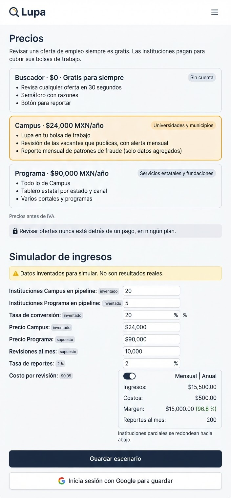
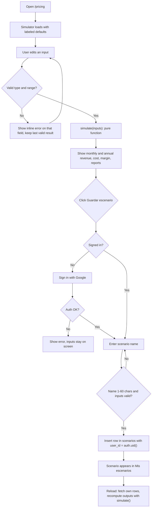
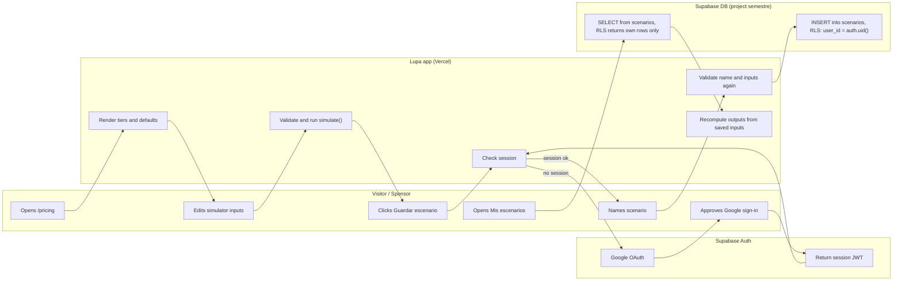

# PACKET: Lupa · Week 14 · Pricing

**Venture:** Lupa ([lupaempleo.xyz](https://lupaempleo.xyz)) · **Repo:** `rafapieck/lupa` · **Author:** Rafael Pieck Guerra · **Role:** USER
**Status:** Spec only. No code is written until this packet is approved.

> **Data labels used in this file**
> - **[INVENTED]**: a made-up default for simulation. Not a measurement, not a forecast.
> - **[ASSUMED]**: a working assumption Rafael chose. Replace it when real data exists.
> - **[CITED, verify]**: a figure from Rafael's research. Confirm the source link before it goes on a public page.

---

## 1. Problem in my words

The job seeker already pays for job fraud today. They don't pay Lupa. They pay the scammer. They pay an advance "fee" for training, uniforms or a medical exam (FTC median reported loss for job scams: US$2,000 **[CITED, verify]**). They pay with their data: a copy of their INE and CURP sent over WhatsApp to a stranger. They pay with risk: Consejo Ciudadano reports that ~30% of people recruited for exploitation are hooked through fake job offers **[CITED, verify]**. And they pay with lost real jobs: every week spent on a fake offer is a week not spent on a real one, and every scam makes the next real posting look suspicious.

So charging the seeker is out. They are already the one losing money, and a paywall in front of a fraud check pushes the most vulnerable people away from it. The price has to sit on the **payer side**, with institutions that already run job boards and already carry the reputational and moral cost when a fraudulent offer reaches their users. Lupa needs a price for those institutions that holds up when someone asks "why that number?". This week builds the page that states the price, the simulator that shows the math behind it, and the first real pricing conversation.

## 2. Exact user

| Segment | Who | What they pay | What they get |
|---|---|---|---|
| **(a) Job seeker** (Buscador) | A person in Mexico who received a job offer by WhatsApp, Facebook, a job board or a flyer and isn't sure whether to trust it. | **$0, free forever.** About 30 seconds of their time. | Paste the offer and get a semáforo (red / yellow / green), the reasons behind it, and a report button. No account needed. |
| **(b1) Institutional payer: Campus** | A university or municipal job board (bolsa de trabajo). First target: Ibero Bolsa de Trabajo. | **$24,000 MXN / year** (before IVA). | Lupa's check linked from **one** portal, **checks on the vacancies the institution posts, with a monthly alert**, and **monthly** aggregated reports of fraud patterns seen on that portal. |
| **(b2) Institutional payer: Programa** | A state employment service (e.g. a state Servicio Nacional de Empleo office) or a foundation running employment programs. | **$90,000 MXN / year** (before IVA). | Everything in Campus, **plus** a state-level fraud-pattern dashboard (aggregated by state and channel only) and coverage for **multiple** portals or programs instead of one. |

The seeker is the user. The institution is the payer. Institutions never receive any individual seeker's data (see §10).

## 3. Success definition

**Before the module closes, all of this works:**

1. **`/pricing` is live** with three tiers: **Buscador $0 · Campus $24,000 MXN/yr · Programa $90,000 MXN/yr**, and a short explanation of the free-versus-paid line: *checking an offer is free in every tier; institutions pay for coverage on their portals and aggregated pattern reports.* The page says that prices are before IVA.
2. **A revenue simulator** on `/pricing` takes these inputs:
   - institutions in pipeline per tier (Campus, Programa)
   - conversion rate
   - price per tier
   - seeker checks per month
   - report rate
   - cost per check
   - (optional) review cost per report

   It returns **monthly and annual revenue, cost and margin**, and shows every assumption and its label on screen.
3. **Signed-in users (Google) can save and reload scenarios** and only ever see their own. Signed-out visitors can use the simulator fully but can't save.
4. **`/about` holds the 10:1 memo** (draft in Appendix A).
5. **The Ibero Bolsa de Trabajo pricing conversation is recorded** in `docs/conversations/ibero.md` (Appendix B). *Done: asked by email on November 10, 2026. The answer was "no, not as asked", because they need more information. The price itself wasn't rejected.* The follow-up is a one-page proposal and a request for a 20-minute meeting (outline in Appendix B).
6. **The seeker-side metric is defined and visible: % of checks that end in a report** (`reports ÷ checks` over a period). It shows whether seekers pay with reports, the way Whoscall/Truecaller users do (§6). In the simulator it is the *report rate* input, which stays [INVENTED] until real counts exist. When it's measured, it's counted in aggregate only, with no offer text and no identity attached.

### Simulator model (the math, stated once)

All money is MXN, before IVA. Tax is out of scope and the screen says so.

```
paying_campus      = floor(campus_pipeline   × conversion_rate)
paying_programa    = floor(programa_pipeline × conversion_rate)

annual_revenue     = paying_campus × campus_price + paying_programa × programa_price
monthly_revenue    = annual_revenue ÷ 12

reports_per_month  = checks_per_month × report_rate
monthly_cost       = checks_per_month × cost_per_check
                   + reports_per_month × review_cost_per_report
annual_cost        = monthly_cost × 12

monthly_margin     = monthly_revenue − monthly_cost
annual_margin      = annual_revenue  − annual_cost
margin_pct         = monthly_margin ÷ monthly_revenue   (shown as "—" when revenue = 0)
```

- **Why `floor`:** you can't sell 0.45 of a license, so partial institutions round **down**. That is the conservative choice, and the screen states it.
- **Rounding:** compute at full precision and round to 2 decimals only for display (margin % to 1 decimal).
- **Report rate** produces `reports_per_month`. This number is shown as the aggregated insight institutions pay for. It costs money only if review cost per report is above 0.

### Default inputs, all [INVENTED] except where marked

| Input | Default | Label |
|---|---|---|
| Campus institutions in pipeline | 20 | [INVENTED] |
| Programa institutions in pipeline | 5 | [INVENTED] |
| Conversion rate | 20% | [INVENTED] |
| Campus price | $24,000 MXN/yr | Lupa list price |
| Programa price | $90,000 MXN/yr | Lupa list price |
| Seeker checks per month | 10,000 | [INVENTED] |
| Report rate | 2% | [INVENTED] |
| Cost per check | $0.05 MXN | [ASSUMED] |
| Review cost per report | $0.00 MXN | [INVENTED] (off by default) |

## 4. Mockup: image-generation prompt



> A high-fidelity mobile app screenshot, iPhone-size portrait (390×844), of a Spanish-language web page for a Mexican job-fraud checker called "Lupa". Clean, trustworthy civic-tech style: white background, deep navy text (#1B2A41), one accent color of warm amber (#F2A900), soft gray cards with 12px rounded corners, generous spacing, a simple sans-serif font like Inter. No stock photos and no people. One small magnifying-glass logo next to the word "Lupa" in the top-left corner, with a hamburger menu on the right.
>
> **Top section**, title: "Precios". Subtitle: "Revisar una oferta de empleo siempre es gratis. Las instituciones pagan para cubrir sus bolsas de trabajo."
>
> **Three stacked tier cards:**
> 1. "Buscador · $0 · Gratis para siempre". Bullets: "Revisa cualquier oferta en 30 segundos", "Semáforo con razones", "Botón para reportar". Small tag: "Sin cuenta".
> 2. "Campus · $24,000 MXN/año". Bullets: "Lupa en tu bolsa de trabajo", "Revisión de las vacantes que publicas, con alerta mensual", "Reporte mensual de patrones de fraude (solo datos agregados)". Amber outline marking it as the recommended plan, tag "Universidades y municipios".
> 3. "Programa · $90,000 MXN/año". Bullets: "Todo lo de Campus", "Tablero estatal por estado y canal", "Varios portales y programas". Tag "Servicios estatales y fundaciones".
>
> Under the cards, small gray text: "Precios antes de IVA." And a highlighted line with a lock-open icon: "Revisar ofertas nunca está detrás de un pago, en ningún plan."
>
> **Simulator section**, title: "Simulador de ingresos". A yellow banner: "Datos inventados para simular. No son resultados reales." Compact input rows with a label on the left and a number field on the right: "Instituciones Campus en pipeline: 20", "Instituciones Programa en pipeline: 5", "Tasa de conversión: 20 %", "Precio Campus: $24,000", "Precio Programa: $90,000", "Revisiones al mes: 10,000", "Tasa de reportes: 2 %", "Costo por revisión: $0.05". Each row has a tiny gray tag reading "inventado" or "supuesto".
>
> A results card with a toggle "Mensual | Anual" set to Mensual. Rows: "Ingresos: $15,500.00", "Costos: $500.00", "Margen: $15,000.00 (96.8 %)", "Reportes al mes: 200". A note under it: "Instituciones parciales se redondean hacia abajo."
>
> At the bottom, a full-width navy button: "Guardar escenario" and beneath it a white button with the Google "G" icon: "Inicia sesión con Google para guardar". The screen shows no word "seguro" or "segura" anywhere.

## 5. Flows (Mermaid)

### 5a. Simulator → calculate → save scenario



### 5b. Swimlane by actor



## 6. Benchmark line

**The best existing solution on Earth for this is ScamShield, a free citizen app and helpline funded by the state because protection is treated as a public good, alongside Whoscall/Truecaller, which are free for users and paid for by businesses and institutions, so that every user report improves the database and the user pays with reports, not money.**
**Mine differs and localizes by applying that same split to one Mexican problem, fake job offers arriving by WhatsApp, Facebook and job boards: the seeker checks the *offer text* for free and pays only with reports, while the universities, municipalities and state employment services that run the job boards pay for coverage and aggregated patterns.**

## 7. Long view (3 years)

If this works, Lupa becomes the default fraud check behind Mexico's university, municipal and state job boards, so that a seeker meets the semáforo wherever they're already looking for work rather than having to find it. The reports from those portals add up to the country's clearest aggregated map of how job fraud moves by state and channel, and state employment services and foundations pay for that map. The seeker side stays free and anonymous by design, because that is what keeps the reports coming and what makes the institutional price defensible.

## 8. Scope cut: NOT building this week

- **No payments.** No checkout, Stripe, invoicing or CFDI. Pricing is a page and a conversation, not a cart.
- **No IVA or tax logic** in the simulator (the screen says "antes de IVA").
- **No Programa dashboard.** The state-level dashboard is described on `/pricing`, not built.
- **No Campus embed or widget** for institutions' portals.
- **No checks on posted vacancies and no monthly alert.** Both are part of what Campus includes and appear on `/pricing`, but building them is a later week.
- **No monthly aggregated report generator.** The first pilot report can be assembled by hand from aggregate counts.
- **No changes to the check itself.** The semáforo logic, the LLM or simulated output and `fraud_patterns` stay as they are.
- **No seeker accounts.** Google sign-in is only for saving scenarios. Checking an offer never requires it.
- **No sharing scenarios** between users, no teams, no public scenario links.
- **No storing computed outputs.** Only inputs are saved, and outputs are recomputed on load.
- **No CRM or email sequences** for institutions. The Ibero log is a markdown file, and the one-page proposal is a document, not a page on the site.
- **No English UI, no multi-currency.**
- **No real numbers.** Every default is invented or assumed, and labeled.

## 9. Architecture and stack

| Layer | Choice | Status | Notes |
|---|---|---|---|
| Hosting | Vercel | Existing | Deploys from `rafapieck/lupa`. Env vars hold all keys. |
| Repo | GitHub `rafapieck/lupa` | Existing | This file lives at `docs/PACKET.md`. |
| Frontend | Lupa's current framework | Existing | New routes: `/pricing` (tiers + simulator), `/about` (10:1 memo). The framework wasn't confirmed in this packet, so no assumption is made here. |
| Simulator logic | `simulate(inputs)`, a pure function with no I/O | **New** | The only place the math lives. Shared by the UI and the tests. Validation is a separate `validateInputs()` used by both the UI and the save path. |
| Database | Supabase project **"semestre"** | Existing | `fraud_patterns` already exists and is untouched. |
| Auth | **Supabase Auth with Google** provider | **New** | Used only for saving scenarios. |
| Scenarios | `public.scenarios` table with **RLS on** | **New** | Schema below. |

### `scenarios` table

```sql
create table public.scenarios (
  id                      uuid primary key default gen_random_uuid(),
  user_id                 uuid not null default auth.uid()
                          references auth.users (id) on delete cascade,
  name                    text not null check (char_length(name) between 1 and 60),
  campus_pipeline         integer not null check (campus_pipeline between 0 and 1000),
  programa_pipeline       integer not null check (programa_pipeline between 0 and 1000),
  conversion_rate         numeric(5,2) not null check (conversion_rate between 0 and 100),   -- percent
  campus_price            integer not null check (campus_price between 0 and 1000000),     -- MXN/yr
  programa_price          integer not null check (programa_price between 0 and 1000000),   -- MXN/yr
  checks_per_month        integer not null check (checks_per_month between 0 and 10000000),
  report_rate             numeric(5,2) not null check (report_rate between 0 and 100),       -- percent
  cost_per_check          numeric(8,4) not null check (cost_per_check between 0 and 100),    -- MXN
  review_cost_per_report  numeric(8,2) not null default 0 check (review_cost_per_report between 0 and 1000),
  formula_version         smallint not null default 1,
  created_at              timestamptz not null default now(),
  updated_at              timestamptz not null default now()
);

alter table public.scenarios enable row level security;

create policy "own scenarios: select" on public.scenarios
  for select to authenticated using (user_id = auth.uid());
create policy "own scenarios: insert" on public.scenarios
  for insert to authenticated with check (user_id = auth.uid());
create policy "own scenarios: update" on public.scenarios
  for update to authenticated using (user_id = auth.uid()) with check (user_id = auth.uid());
create policy "own scenarios: delete" on public.scenarios
  for delete to authenticated using (user_id = auth.uid());
-- No policy for anon, so anonymous users can't read or write anything.
```

The database `check` constraints repeat the UI range limits on purpose, so a crafted request that skips the UI is still rejected. `formula_version` lets old scenarios be recomputed correctly if the math changes later.

## 10. Shadow clause → design rules

The shadow of a fraud checker is false reassurance. The shadow of an institutional price is the payer's interests overriding the seeker's. These rules guard against both:

1. **Lupa never says "safe".** Not in English, and not "segura", "confiable" or "legítima" in Spanish. Green reads *"No encontramos señales de alerta"* (we found no warning signs), never "esta oferta es segura". This applies to the semáforo, `/pricing`, `/about`, tier descriptions and marketing copy.
2. **Checking an offer is never behind a paywall, in any tier.** No check limits, no "premium reasons" and no account required. Paid tiers buy coverage and aggregated reports, never better protection for some seekers.
3. **Institutions only get aggregated data, never an individual seeker's.** Reports go out as counts and patterns by state, channel and pattern type. No offer text that could identify a seeker, no names, phones, emails, IPs or INE/CURP data. Small groups are suppressed rather than shown (a minimum group size is set when the dashboard is built, out of scope this week, but `/pricing` copy must already promise this).
4. **The simulator never presents invented numbers as real.** Every default carries its label on screen, and a banner says the data is invented.
5. **A simulated semáforo says it's simulated.** If the check's output comes from a simulation and not a live analysis, the result screen shows **"Resultado simulado"** next to the semáforo. Whether the output is simulated today gets verified in the repo during the build.

## 11. Security floor checklist

- [ ] **No secrets in the repo.** Supabase service-role key, Google OAuth client secret and any LLM key live only in Vercel env vars or the Supabase dashboard. Only the Supabase URL and anon key reach the browser. A secret scan of the repo is clean before merging.
- [ ] **The service-role key is never used in client code.** All scenario reads and writes go through the user's session, so RLS applies.
- [ ] **Auth is required for saved scenarios.** Saving and loading need a Google session, while the simulator itself works signed out.
- [ ] **RLS is on for `scenarios`**, with policies for select, insert, update and delete scoped to `auth.uid()` and no anon policy.
- [ ] **Google OAuth redirect URLs are allowlisted** to the production domain and the Vercel preview domain only.
- [ ] **Every simulator field is validated for type and range**, in the UI and again in the DB:

  | Field | Type | Range | Step |
  |---|---|---|---|
  | Campus / Programa pipeline | integer | 0–1,000 | 1 |
  | Conversion rate | number (%) | 0–100 | 0.01 |
  | Campus / Programa price | integer (MXN) | 0–1,000,000 | 1 |
  | Checks per month | integer | 0–10,000,000 | 1 |
  | Report rate | number (%) | 0–100 | 0.01 |
  | Cost per check | number (MXN) | 0–100 | 0.0001 |
  | Review cost per report | number (MXN) | 0–1,000 | 0.01 |
  | Scenario name | text | 1–60 chars, trimmed | — |

  Empty, NaN, negative, out-of-range, scientific notation like `1e9`, and non-numeric input are rejected with an inline error.
- [ ] **Only invented or labeled data.** No real institution's numbers appear in defaults or screenshots, and the Ibero log stays in `docs/` and is never shown on a public page without consent.
- [ ] **Scenario names are rendered as text, never as HTML**, to prevent XSS.

## 12. Test plan

### 12a. Simulator cases, calculated by hand

**Case 1: defaults (the mockup numbers)**
Inputs: Campus pipeline 20, Programa pipeline 5, conversion 20%, Campus price 24,000, Programa price 90,000, checks 10,000/mo, report rate 2%, cost per check 0.05, review cost 0.

| Step | Arithmetic | Result |
|---|---|---|
| Paying Campus | floor(20 × 0.20) = floor(4.0) | **4** |
| Paying Programa | floor(5 × 0.20) = floor(1.0) | **1** |
| Annual revenue | 4 × 24,000 + 1 × 90,000 = 96,000 + 90,000 | **$186,000.00** |
| Monthly revenue | 186,000 ÷ 12 | **$15,500.00** |
| Reports/month | 10,000 × 0.02 | **200** |
| Monthly cost | 10,000 × 0.05 + 200 × 0 = 500 + 0 | **$500.00** |
| Annual cost | 500 × 12 | **$6,000.00** |
| Monthly margin | 15,500 − 500 | **$15,000.00** |
| Annual margin | 186,000 − 6,000 | **$180,000.00** |
| Margin % | 15,000 ÷ 15,500 = 0.96774… | **96.8%** |

**Case 2: no institutions yet (the free side still costs money)**
Inputs: Campus pipeline 0, Programa pipeline 0, conversion 20%, prices at list, checks 50,000/mo, report rate 3%, cost per check 0.05, review cost 0.

| Step | Arithmetic | Result |
|---|---|---|
| Paying Campus / Programa | floor(0 × 0.20) | **0 / 0** |
| Annual / monthly revenue | 0 | **$0.00 / $0.00** |
| Reports/month | 50,000 × 0.03 | **1,500** |
| Monthly cost | 50,000 × 0.05 + 1,500 × 0 | **$2,500.00** |
| Annual cost | 2,500 × 12 | **$30,000.00** |
| Monthly margin | 0 − 2,500 | **−$2,500.00** |
| Annual margin | 0 − 30,000 | **−$30,000.00** |
| Margin % | revenue = 0, so no division | **"—"** (not NaN, not −∞) |

Also check: the checks stay free and the simulator does **not** suggest charging seekers.

**Case 3: rounding down, custom price, review cost on (a loss)**
Inputs: Campus pipeline 7, Programa pipeline 3, conversion 15%, Campus price **30,000**, Programa price 90,000, checks 200,000/mo, report rate 1.5%, cost per check 0.05, review cost **1.00**.

| Step | Arithmetic | Result |
|---|---|---|
| Paying Campus | floor(7 × 0.15) = floor(1.05) | **1** |
| Paying Programa | floor(3 × 0.15) = floor(0.45) | **0** |
| Annual revenue | 1 × 30,000 + 0 × 90,000 | **$30,000.00** |
| Monthly revenue | 30,000 ÷ 12 | **$2,500.00** |
| Reports/month | 200,000 × 0.015 | **3,000** |
| Monthly cost | 200,000 × 0.05 + 3,000 × 1.00 = 10,000 + 3,000 | **$13,000.00** |
| Annual cost | 13,000 × 12 | **$156,000.00** |
| Monthly margin | 2,500 − 13,000 | **−$10,500.00** |
| Annual margin | 30,000 − 156,000 | **−$126,000.00** |
| Margin % | −10,500 ÷ 2,500 = −4.2 | **−420.0%** |

Also check: the UI shows negative margins clearly (sign and color) and doesn't hide them.

### 12b. Validation cases

| Input | Expected |
|---|---|
| Conversion rate = 101 | Rejected: "Debe estar entre 0 y 100". Last valid result stays on screen. |
| Campus pipeline = 2.5 | Rejected (must be an integer). |
| Checks per month = −1 | Rejected. |
| Cost per check = "abc" or empty | Rejected and the field is marked. |
| Price = 1e9 | Rejected (scientific notation and out of range). |
| Scenario name = 61 chars or only spaces | Rejected, nothing saved. |
| A crafted API insert with conversion_rate = 500 | Rejected by the DB `check` constraint. |

### 12c. Auth and RLS checks

| # | Test | Expected |
|---|---|---|
| 1 | Signed out: use the simulator | Works fully. "Guardar" prompts Google sign-in. |
| 2 | Signed out: check a job offer | Works with no sign-in prompt. |
| 3 | Anon key, no session: `select * from scenarios` | 0 rows (no anon policy). |
| 4 | Anon key, no session: insert a scenario | Rejected. |
| 5 | User A saves "Escenario A", then reloads the page | A sees it, and outputs match Case 1 if defaults were saved. |
| 6 | User B signs in and lists scenarios | B doesn't see "Escenario A". |
| 7 | User B: `select` A's row by its `id` | 0 rows. |
| 8 | User B: `update` or `delete` A's row by `id` | 0 rows affected, A's row unchanged. |
| 9 | User B: insert with `user_id` = A's id | Rejected by the `with check` policy. |
| 10 | Sign out, then reload `/pricing` | No saved scenarios visible and no cached data from A. |
| 11 | Search the client bundle for `service_role` or the secret key | Not found. |

### 12d. Design-rule checks

- [ ] Search all UI copy for `safe`, `segur`, `confiable` and `legítim`. No hits in a claim about an offer.
- [ ] Every tier card on `/pricing` states that checking an offer is free.
- [ ] Every simulator default shows its label ([INVENTED] or [ASSUMED]), and the "datos inventados" banner is visible.
- [ ] "Precios antes de IVA" is visible on `/pricing`.
- [ ] Programa copy says "agregado por estado y canal" and promises no individual data.
- [ ] In the repo, find where the semáforo output comes from. If it's simulated, every result screen shows "Resultado simulado" (test red, yellow and green). If it's a live call, record that in `docs/DECISIONS.md`.
- [ ] The Campus card lists "Revisión de las vacantes que publicas, con alerta mensual", and nothing on `/pricing` implies that feature is live today.

---

## Appendix A: 10:1 memo (draft for `/about`)

> **Why Lupa is free for job seekers, and why an institution pays**
>
> Lupa follows one rule for pricing: whoever uses it should get roughly ten times more value than it costs them. *(Rafael: this memo is drafted in English for review. Translate it for `/about` once the wording is approved.)*
>
> **For the job seeker, the ratio isn't close.** Lupa costs $0 and about 30 seconds. On the other side is the advance fee a fake recruiter asks for. In the US, the FTC reports a median loss of about US$2,000 per job-scam victim **[CITED, verify]**, roughly $36,000 MXN at an assumed $18 MXN per dollar **[ASSUMED]**. Then there are their documents: an INE or CURP sent to a stranger can be used for fraud long after the fake job disappears. And there is their physical safety: Consejo Ciudadano reports that about 30% of people recruited for exploitation are reached through fake job offers **[CITED, verify]**. Against those costs, any price we charged the seeker would only push them away from checking. So checking an offer is free, in every plan, permanently.
>
> **For an institution, the ratio holds with one person.** A university or municipal job board pays $24,000 MXN a year for Campus. The money one median victim loses, by the estimate above, is already larger than that license. That's before counting what can't be priced: a student who sent their documents, a family that paid a "training fee", or a student who walked into a meeting that wasn't an interview. If Lupa helps one student on that board avoid one of those outcomes, the license has paid for itself. Every other warning it gives that year is the rest of the ratio.
>
> **What institutions don't get.** They don't get any individual seeker's data, ever. They get aggregated patterns (which channels, which kinds of offers, which states), so they can warn their community. Lupa never tells anyone an offer is "safe". It tells them what warning signs it found, or that it found none.
>
> *Figures marked [CITED, verify] need their source links checked before publishing. The exchange rate is an assumption.*

## Appendix B: Ibero Bolsa de Trabajo pricing conversation

This is the record for `docs/conversations/ibero.md`. It reflects what Rafael reported and nothing else.

### Log

| Field | Record |
|---|---|
| Date asked | Tuesday, November 10, 2026 |
| Channel | Email |
| To | Ibero Bolsa de Trabajo |
| Responder | Name not given. The reply came from the Bolsa de Trabajo office. |
| Question asked (verbatim) | "If Lupa checked every vacancy you publish and warned your students about fake offers, would you pay $24,000 MXN a year?" |
| Answer | **No, not as asked.** They would need to know much more about the whole thing before deciding. |
| What it means | The price wasn't rejected. The proposal was too thin. **The blocker is information, not the number.** |
| Next step | Send a one-page proposal (outline below) and ask for a 20-minute meeting. |
| Price change? | None. $24,000 MXN/yr stays until a conversation gives a reason about the number itself. |

### What I learned

- An email with one sentence and one price isn't enough for an institution to decide. They need to see the whole thing first.
- A "no" here is not evidence against $24,000. It's evidence that the offer needs to be explained.
- The question promised that Lupa would **check every vacancy they publish**, and that is part of Campus. The proposal has to explain it next to the student-side check and the monthly reports, and be honest that it's still being built.

### One-page proposal outline (for Ibero, Campus tier)

Target: one page, in Spanish, sent by email to the Bolsa de Trabajo office.

1. **The problem, in their terms (2–3 lines).** Fake job offers reach students on job boards, WhatsApp and Facebook. They cost students advance fees and documents (INE/CURP), and sometimes put them at risk. Use only the [CITED, verify] figures from Appendix A, with their sources.
2. **What Lupa is (2 lines).** A student pastes an offer and gets a semáforo (red / yellow / green) with the reasons, plus a report button. It's free for students in every plan, needs no account, and never says an offer is "segura".
3. **What Campus includes.**
   - Lupa's check made available to Ibero students from the Bolsa de Trabajo portal.
   - **Checks on the vacancies Ibero posts, with a monthly alert** about any that show warning signs. Say plainly that this is in development and give no launch date, because it isn't built yet (§8).
   - **A monthly aggregated report** of fraud patterns seen by Ibero's users (channels, types of offer, warning signs).
4. **How it works with their portal.** For the pilot, the portal adds a visible link or button ("Revisa esta oferta con Lupa") that opens lupaempleo.xyz. There's no integration work on their side. An embedded widget is a later option and isn't built yet (see §8).
5. **Data: aggregated only.** Ibero never receives any individual student's data, and Lupa doesn't ask students to identify themselves. Reports contain counts and patterns only, and small groups are suppressed.
6. **Price.** $24,000 MXN a year, before IVA, for one portal. One sentence on the 10:1 logic: one avoided case is worth more than the license.
7. **Pilot: 1 month, free.** Success means (a) the number of checks that come from the Bolsa de Trabajo portal and (b) one aggregated report delivered at the end of the month.
8. **The ask.** A 20-minute meeting, with two or three proposed time slots and a single contact person.

Don't include features outside this packet, real numbers from other institutions, or anything that suggests Lupa guarantees an offer is legitimate.
