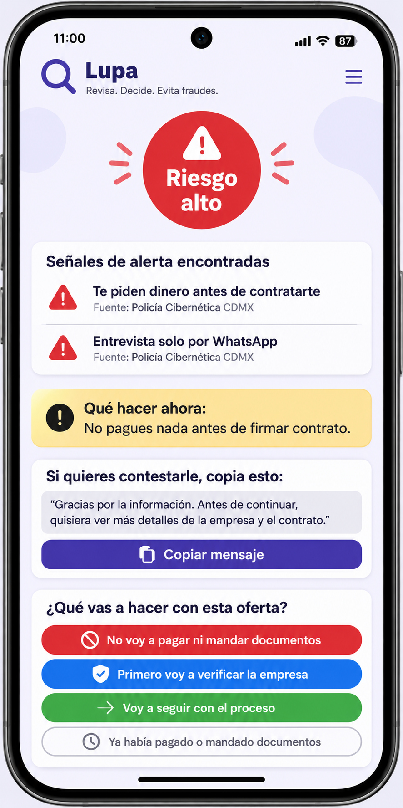
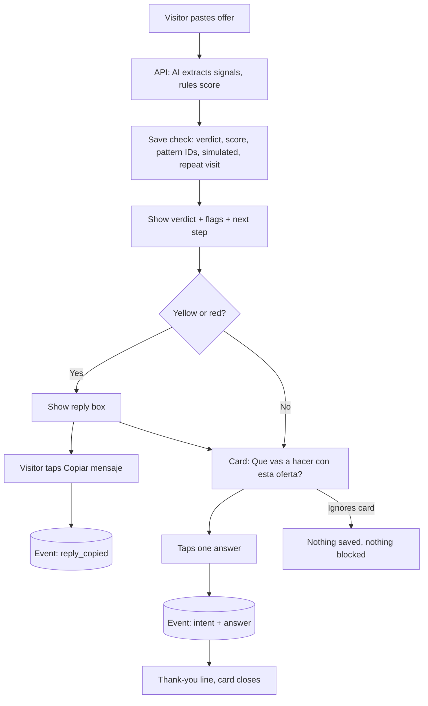
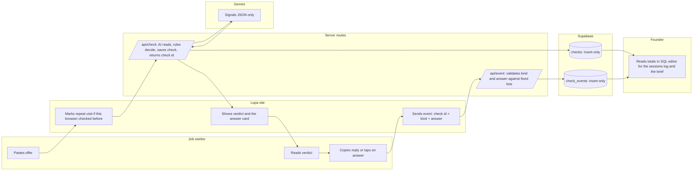

# PACKET — Lupa · Week 13 · Real Humans (five users who don't love you)

**Founder:** Rafael Pieck Guerra · **Venture:** Lupa (Weeks 12–17) · **Repo:** `rafapieck/lupa` · **URL of record:** `www.lupaempleo.xyz`
**Method:** *Proof Before Verdict*. The AI reads; verified rules decide.
**Referee:** `docs/CHARTER.md` · **Personas:** `docs/PERSONAS.md` · **Week 12 packet:** in git history

> Packet before code. This file was committed before any Week 13 application code.
> §13 (the #1 real-user pain and its fix) is filled **after** the first real sessions, in its own commit, before the fix is coded.

---

## 1. Problem (in my words)

Lupa already gives a sourced verdict on a pasted job offer. What it can't tell me is whether that verdict changed anything. A green, yellow or red light that nobody acts on is a nice screen, not prevention. This week Lupa leaves the persona lab and meets real job-seekers, and I need two things it doesn't have: a way to see what real people do after the verdict, and the one fix that real people (not my synthetic Jorge) show me matters most.

## 2. Exact user

Real people looking for entry-level work **right now**, who find offers in Facebook groups and WhatsApp forwards: the population behind Karla (19, Ecatepec) and Jorge (27, Iztapalapa) in `docs/PERSONAS.md`.

**This week's five:** at least 3 of 5 are strangers to me. Recruited from job-seeker Facebook groups, a job fair and the line at an employment office, not classmates. Each one is recorded by role, never by name.

## 3. Success definition

> **Before the module closes**, at `www.lupaempleo.xyz`:
> 1. After every verdict, the visitor can answer **one anonymous tap**: "¿Qué vas a hacer con esta oferta?" The answer is saved as an event linked to that check, with no offer text and no user data.
> 2. Copying the suggested reply is saved as an event too, so I can see who **acted**, not only who read.
> 3. Each check records whether this browser had checked before (`repeat_visit`), with no ID, cookie or personal data, so a **return visit is provable**.
> 4. The #1 pain found in the real sessions (§13) is fixed and redeployed, with before/after screenshots.

## 4. Mockup (image-generated)

*Image-generated: the red verdict screen, with "Qué hacer ahora" and the "Copiar mensaje" box, followed by a new card that says "¿Qué vas a hacer con esta oferta?" and has four large buttons.*

## 5. Flow

### 5.1 Flowchart — verdict → action → evidence

### 5.2 Swimlane — who does what

## 6. Benchmark

**The best existing solution on Earth for this is** Singapore's ScamShield: a free government app and helpline where anyone checks a suspicious message in one tap, and reports flow back to the police.
**Mine differs or localizes by** closing the loop on the *job-seeker's decision*: instead of only checking, Lupa records (anonymously) whether the person paused before paying, with Mexican job-scam patterns, Mexican sources and no State behind it yet.

## 7. Long view (3 years)

If this slice works, Lupa stops counting checks and starts counting **pauses**: how many people were asked for money and didn't pay. That number becomes the product a sponsor buys: job boards losing applicants to fear, banks and fintechs handling fraud claims, and public employment programs. With it, Lupa becomes the WhatsApp number people forward offers to, and its anonymous pause data becomes the map of where job scams are active this week.

## 8. Who pays (updated after the Week 13 MONEY brief)

The job seeker never pays, and no employer can buy a verdict (Charter). Payers, ordered by incentive: **job boards** (they lose applicants to doubt), **banks and fintechs** (they absorb the fraud claims), then **public employment programs**. The number every payer buys is the same: detected money requests where the person did not pay. *Open question: what one fraud claim costs a Mexican bank to handle.*

## 9. Blueprint conditions honored (incl. shadow clause)

| Condition | How Lupa honors it |
|---|---|
| **Shadow clause: false validation.** A product that looks proven because testers were polite; for Lupa, a false "safe" lends a scammer my credibility | Lupa never says "safe" (copy audit test). Sessions count only **behaviors** (a copy, an answer, a return), never "I liked it". The sponsor number counts only money requests not paid, never visits or total checks |
| **Forbidden zone:** no friends-and-family-only testing | 3 of 5 users are strangers; recruiting channel logged per session |
| **AI never decides** | Unchanged: rules-only verdict in `lib/score.ts` |
| **No text or user data stored** | `check_events` holds only check id, kind, answer and date. `repeat_visit` is a yes/no computed in the browser; no ID, cookie or fingerprint is sent |

## 10. Scope cut — NOT building this week

- ❌ WhatsApp bot and screenshot reading (3-year vision), even though it's my timing hypothesis. It only enters this week if the real sessions rank it #1 *and* it fits one fix
- ❌ Accounts, login, email capture or any way to contact the user
- ❌ A public dashboard of events. The founder reads totals in the SQL editor
- ❌ Free-text feedback (it would invite personal data). Fixed answers only
- ❌ More than one fix from the sessions (one fix per round, per the Charter)

## 11. Architecture + stack

| Layer | Tool | Notes |
|---|---|---|
| Site | Next.js (App Router) + Tailwind | `/` checker · `/product` · `/about` |
| Hosting + domain | Vercel + `www.lupaempleo.xyz` | URL of record |
| AI | Google Gemini Flash Lite (free tier) | Extracts signals only; keyword fallback labeled on screen |
| Rules | `lib/score.ts` | Deterministic, tested |
| Saved checks | Supabase `checks` | RLS ON, insert-only. **New:** server-generated `id` returned to the browser, and a `repeat_visit` boolean |
| **New: event log** | Supabase `check_events` | RLS ON, insert-only. Columns: `id`, `created_at`, `check_id` (FK to checks), `kind` (`reply_copied` / `intent`), `answer` (fixed list or null) |
| **New: event route** | `POST /api/event` | Validates check id (uuid), kind and answer against fixed lists; never blocks the UI |
| Secrets | Vercel env vars only | |

**Intent answers (fixed list):** `no_pay` "No voy a pagar ni mandar documentos" · `verify` "Primero voy a verificar la empresa" · `continue` "Voy a seguir con el proceso" · `already_paid` "Ya había pagado o mandado documentos".

**What the founder can count (SQL editor):** checks with a money pattern matched → share with an `intent` event → share answering `no_pay` or `verify` (the "pause rate") · `reply_copied` per red/yellow check · share of `repeat_visit` checks.

## 12. Test plan

**Mechanical pass**
1. The 5 invented offers still return 🔴🔴🔴🟢🟡, and the prompt-injection offer stays 🔴.
2. `/api/check` returns a `checkId` (uuid) and saves exactly one row with that id; the row has no text.
3. `/api/event` accepts only a valid uuid, a known `kind`, and for `intent` only one of the 4 answers; anything else → 400, nothing saved.
4. Anon key cannot `select`, `update` or `delete` `check_events` (RLS); an event for a non-existent check id is rejected by the foreign key.
5. Tapping an answer shows the thank-you line even if the save fails (saving never blocks the UI).
6. `repeat_visit` is false on the first check in a fresh browser and true on the second; nothing else about the browser is sent.
7. Copy audit still passes: no "segura" / "es real" in any new text.
8. Security floor: no keys in the repo (`git grep`), inputs validated on client and server, RLS on both tables.
9. Find at least one bug, fix it, redeploy, log it in `DECISIONS.md`.

**Real-user pass (Layer 2):** 5 sessions logged in `docs/USER_SESSIONS.md`: role, recruiting channel, stranger yes/no, what they tried, where they struggled, exact quotes, and what they did (copied, answered, returned). Pain ranking: the 3 worst findings, ordered by how much they threaten the 10:1 case.

**Persona pass (Layer 1):** fresh chat as a persona built from the real users, walking home → result → answer card. Log every hesitation, fix the worst one, and save as `PERSONA_RafaelPieck.pdf`.

## 13. #1 real-user pain and fix

*Filled after the first real sessions, committed before the fix is coded.*

**Hypothesis going in (from my MONEY brief):** timing, not accuracy. People paste an offer when curious, not at the moment a recruiter demands money, so the check arrives after the deposit. **The real users outrank this hypothesis.**

| | |
|---|---|
| Pain #1 (from sessions) | Offers arrive as **images** (WhatsApp flyers, screenshots of chats) and can't be pasted, so the person gets no verdict at all |
| Who showed it + quote | Persona test, synthetic users #1 and #3 (`docs/PERSONA_TEST_WEEK13.md`); to confirm with the real sessions in `docs/USER_SESSIONS.md`: "La oferta me llegó en foto, ¿cómo la pego? Nadie va a escribir todo eso." |
| Why it threatens the 10:1 case | No verdict means no pause. It hits at the exact moment the recruiter asks for money: the timing hypothesis from the MONEY brief in its most concrete form |
| The fix (one feature) | **"Subir captura o foto"** on the home screen. The image goes to the server, Gemini only **transcribes the text** (no verdict), and that text runs through the same validation, signals and rules. Neither the image nor the transcribed text is stored. If Gemini is unavailable, a friendly message asks to paste the text instead |
| Before / after evidence | Before: home screen with only the paste box (screenshot). After: the same offer as an image → 🔴 with flags and sources (screenshot) |

**Scope note:** §10 put screenshot reading out of scope unless the sessions ranked it #1 and it fit one fix. The persona test ranked it #1 and it fits one fix, so it moves in as one feature: one image per check, JPG/PNG/WebP up to 4 MB, no gallery, no other OCR.
