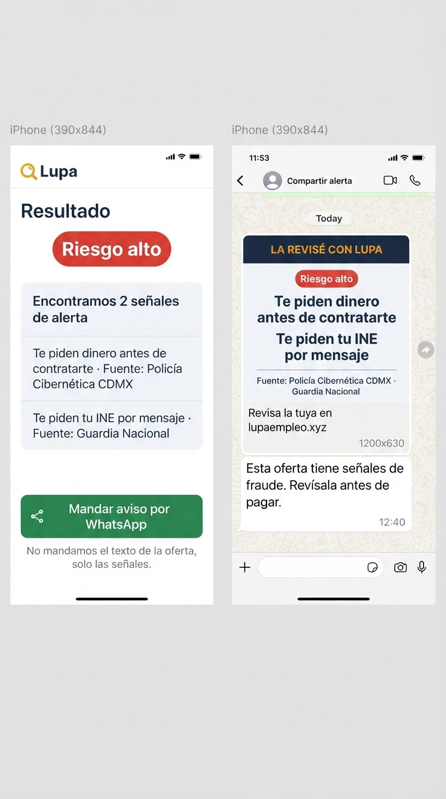
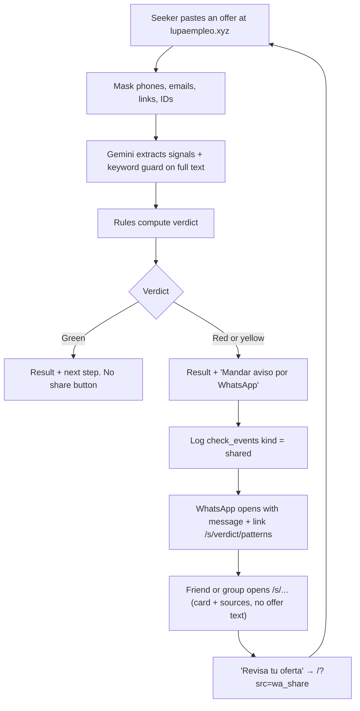
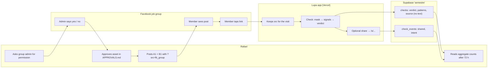

# PACKET: Lupa · Week 15 · Distribution

**Venture:** Lupa ([lupaempleo.xyz](https://lupaempleo.xyz)) · **Repo:** `rafapieck/lupa` · **Author:** Rafael Pieck Guerra · **Role this week:** TECHNOLOGIST
**Status:** Spec only. No code is written until this packet is approved.
**What changed since Week 14:** the first audience moved from “students reached through university job boards” to “job seekers in WhatsApp and Facebook groups at the moment of a deposit request” (Brain Bending brief, Week 15). Pricing, payers and every Week 14 feature stay as they are.

> **Data labels used in this file**
> - **[INVENTED]**: a made-up value for a demo or simulation. Not a measurement.
> - **[ASSUMED]**: a working assumption Rafael chose. Replace it when real data exists.
> - **[CITED]**: a figure from a linked public source.
> - **[TO FILL]**: filled in by Rafael after the distribution test. Never filled with a guess.

---

## 1. Problem in my words

Lupa works once an offer is on its page. Getting the offer there is the problem. Fake job offers reach people where Lupa isn’t: Consejo Ciudadano CDMX reported that most arrive by direct messages to the phone (25%), WhatsApp (20%) and Facebook (16%) **[CITED]**. None of my 5 Week 13 users came through a job board, and all 5 had been asked for money before working.

In a feed full of synthetic “tips” and fake recruiters, one more scary post doesn’t help. Lupa’s content has to be *the product working*: a real fraud signal, its official source, and one thing to do now. The verdict also has to travel back into the chat where the person would have asked anyway (“¿alguien ya fue?”). This week builds a launch playbook, a creative method that turns one input into on-brand content, three finished assets, and the small product changes that let a verdict be shared and let me count honestly what the test produced.

## 2. Exact user

| Who | What they pay | What they get this week |
|---|---|---|
| **Job seeker (user).** 18–40, CDMX and Edomex, Android on limited data, looking for work in Facebook groups and WhatsApp forwards, being pushed to pay or send their INE *today*. | $0, always. | A shareable verdict card to send to their group or a relative, plus content that teaches one signal at a time. |
| **Group admin / relative (secondary audience).** Runs or sits in the job group where the offer was posted. | $0. | A link that shows the warning signs and their official source, without the original offer text. |
| **Institutional payer.** Unchanged from Week 14 (Campus / Programa). | Unchanged. | Nothing new this week. Not the channel for the launch test. |

**Not targeting this week:** recruiters and employers, people who already paid (Lupa refers them to 088 and Consejo Ciudadano), phone-call scams, Ibero students as first users.

---

## 3. Launch playbook

### 3a. Strategy

| | |
|---|---|
| **Audience** | Job seekers in Facebook job groups and WhatsApp (section 2). |
| **Need** | Decide in minutes, alone, whether to pay or send documents to a “recruiter” who is pushing for today. |
| **Positioning** | *The second opinion before you pay.* The only free check made for Mexican job scams that shows the official source of every warning sign. |
| **Supporting evidence** | 5 of 5 Week 13 users had been asked for money ($250–$1,000 MXN) before working. User #3 got suspicious because of same-day pressure. Channel mix from Consejo Ciudadano **[CITED]**. Every pattern in `fraud_patterns` names its source (Policía Cibernética CDMX, Guardia Nacional, SSC). |
| **The promise we will NOT make** | **“Te decimos si una oferta es real o segura.”** Lupa only says which known warning signs it found. Green means “no encontramos señales”, never “safe”. |

### 3b. Brand

**Voice rules (three):**
1. **Like a cousin who already went through it.** *Tú*, short sentences, everyday words (*chamba*, *depósito*). No legal or tech jargon.
2. **Every warning names its source.** If we can’t cite an official alert, we don’t say it.
3. **End with one action, never with fear.** No “¡CUIDADO!”, no skulls, no countdowns. One calm next step.

**One weak line, rewritten:**

| Before (current site description) | After |
|---|---|
| “Pega una oferta de trabajo y Lupa te dice si tiene señales de fraude.” | “¿Te piden dinero antes de contratarte? Pega la oferta y ve qué señales de fraude tiene y de qué alerta oficial viene cada una.” |

*Why:* the old line starts with the product. The new one starts with the user’s moment (the money request), keeps the promise narrow (signals, not “real or fake”) and adds the trust reason (official source).

**Palette** (reuses the app and the Week 14 mockup, so the cards and the site look like one thing):

| Role | Color | Use |
|---|---|---|
| Ink | Navy `#1B2A41` | Text, background of the series band |
| Accent | Amber `#F2A900` | Series label, highlights, the Lupa mark |
| Surface | White `#FFFFFF` / Gray `#F3F4F6` | Card backgrounds |
| Semáforo | Tailwind red-700 / amber-300 / green-700 (already in `result-view.tsx`) | Only on verdict cards, never decoration |

**Type hierarchy** (system sans-serif, as on the site; no web fonts, so cards load fast on limited data):

| Level | Size on a 1080-px card | Weight |
|---|---|---|
| Series label | 34 px, all caps | Bold, amber |
| Headline (the signal) | 72–84 px, max 8 words | Bold, navy |
| Body | 40 px, max 30 words | Regular |
| Source chip | 30 px | Regular, gray, starts with “Fuente:” |
| Footer | 30 px | Bold: `lupaempleo.xyz` |

**Repeatable layout, “la tarjeta Lupa”:** top band (series label) → one big line (the signal) → one body line → source chip → footer with one action and `lupaempleo.xyz`. Same five slots in every format; only the proportions change.

**Fit with the audience and the Mexican context:**
- **The semáforo is already familiar.** Mexicans read red, yellow and green as risk levels from the COVID *semáforo epidemiológico*.
- **WhatsApp is how warnings travel** in families and job groups, so every asset is a single image or link that previews well when forwarded.
- **Android on limited data:** cards are PNGs under 150 KB, with no video autoplay and no web fonts.
- **Official sources build trust**, because scammers impersonate brands. Naming Policía Cibernética or Guardia Nacional is the difference between Lupa and one more anonymous post.

### 3c. Creative range: 3 series × 2 concepts

| Series | Purpose | Concept 1 (status) | Concept 2 (status) | Format |
|---|---|---|---|---|
| **A · Señal de la semana** | Teach one fraud signal at a time, with its source | **A1 “Te piden dinero antes de contratarte”** (pattern `upfront_payment`, Policía Cibernética CDMX). **FINISHED** | A2 “Te piden tu INE por WhatsApp” (`personal_documents`, Guardia Nacional). Sketch: headline only | Square 1080×1080 PNG (Facebook group post) |
| **B · La revisé con Lupa** | Show the method: real input → verdict | **B1 the shared verdict card** from one real offer (section 3d). **FINISHED** | B2 “Chamba en el Mundial 2026”: a seasonal offer type. Sketch: headline + which patterns it would hit | Link preview 1200×630 (WhatsApp / Facebook) |
| **C · Antes de depositar** | A pause the person can use without Lupa | **C1 “3 cosas antes de depositar”**: 1) ¿te piden dinero antes de contratarte? 2) ¿la empresa tiene dirección y RFC? 3) pega la oferta en Lupa. **FINISHED** | C2 “Qué contestarle al reclutador”: reuses the `reply_es` lines that already exist. Sketch: headline + one reply | Vertical 1080×1920 PNG (WhatsApp status) |

Three finished assets (A1, B1, C1) across three formats. A2, B2 and C2 stay as purposeful sketches in `docs/content/CONCEPTS.md`.

**All three finished assets are drawn by Lupa itself** from the same data the checker uses (section 7, F1 and F3). A signal changes in `fraud_patterns`, and the card changes with it. That is the method feeding the audience: no copy can drift from the source.

### 3d. The method: one real input → useful output

**Input:** a real job offer from a public Facebook job group, copied by Rafael with the recruiter’s phone, names and links removed before pasting. **[TO FILL: date and group type, never the group’s name or the poster.]** If no real public offer fits, the fallback input is an invented test offer, clearly labeled *“Ejemplo con datos de prueba”*.

**Method (6 roles, separate chats, human approval at the end):**

| # | Role | Input | Output | Quality check |
|---|---|---|---|---|
| 1 | **Research** | The pattern row from `fraud_patterns` + its official alert | A 3-line fact sheet with the alert’s link | Rafael opens every link. No link, no fact. |
| 2 | **Writing** | Fact sheet + the three voice rules | Headline ≤ 8 words, body ≤ 30 words, one action | Word counts, *tú*, no “segura/confiable/legítima”, ends in an action |
| 3 | **Visual production** | Approved copy + layout slots | The card, rendered by `/api/card` (or `/s/...` for B1) | Readable at 390 px wide, < 150 KB, contrast passes |
| 4 | **Evidence / claim check** | Draft card + fact sheet | Pass/fail per claim | Any claim without a source is cut, not softened |
| 5 | **Style review** | Draft card + this section 3b | Checklist: palette, type, 5 layout slots, voice | All boxes pass or go to revision |
| 6 | **Revision** | Findings from 4 and 5 | v2 of the card | Roles 4 and 5 run again on v2 |
| ✋ | **Human approval** | v2 + both checklists | Rafael’s sign-off line in `docs/content/APPROVALS.md` (date, asset, “aprobado”) | Nothing is posted without this line |

For B1 the “visual production” role is the product itself: paste the offer → Lupa returns the verdict → tap **“Mandar aviso por WhatsApp”** → the card at `/s/...` is the asset. The pasted text never leaves the check screen.

### 3e. Distribution test

- **Channel: one Facebook job group in CDMX/Edomex**, posted **only with the admin’s permission** (asked by Messenger first; the request and answer are logged without names). If no admin answers by Wednesday, the fallback is Rafael’s own WhatsApp status, which only his contacts who choose to open it will see.
- **Two pieces:** A1 (square image, posted with the link) and B1 (the shared verdict link).
- **Working next action:** each link opens Lupa’s check with a source tag: `lupaempleo.xyz/?src=fb_group` (or `?src=wa_status`). The tag is the “capture”: it counts checks per channel without collecting anything about the person.
- **What gets counted (aggregate only):** checks with `source = fb_group` (or `wa_status`), how many of them came back 🔴/🟡, and how many verdicts were shared (`check_events.kind = 'shared'`). Plus what Facebook shows the poster (reactions, comments, shares), copied as numbers with no names.
- **No** engagement bait, purchased reach, giveaways, fake comments, or Rafael asking friends to like the post.

### 3f. Honest results (filled after the test)

| | Expected [ASSUMED] | What actually happened [TO FILL] |
|---|---|---|
| Admin permission | 1 of 3 admins says yes | |
| Post reach (what Facebook shows) | 300–800 views | |
| Checks with `src` tag in 72 h | 5–15 | |
| Of those, 🔴 or 🟡 | ≥ 50% | |
| Verdicts shared | 1–3 | |
| Comments asking “¿esta es real?” | 1–2 | |
| **Keep** | | |
| **Change** | | |

Zero is a valid result and gets reported as zero. No personal data, screenshots with names, or profile pictures go into this table, the repo or the demo.

---

## 4. Success definition

Before the module closes, all of this works on the live site:

1. **The share flow works.** On a 🔴 or 🟡 result, a button **“Mandar aviso por WhatsApp”** opens WhatsApp with a short message and a link to `/s/<verdict>/<pattern ids>`. That page shows the verdict card (signals, official sources, one action, “Revisa tu oferta” button) and has a 1200×630 link preview image. **No offer text, company name, phone or date of the original check appears on it.**
2. **Green is never shareable.** There is no share button on 🟢, and `/s/green/...` returns 404. A shared “no encontramos señales” card would read as an endorsement of the offer.
3. **Source tags are counted.** `?src=` on any page is kept for the visit and saved with the check, from a fixed list only (`fb_group`, `wa_status`, `wa_share`, `contenido`, `direct`). Anything else is ignored.
4. **`shared` is a new event kind** in `check_events`, logged when the share button is tapped.
5. **`/api/card` renders the series cards** (A1 square, C1 vertical) from `fraud_patterns`, in the brand layout, as PNG.
6. **`/contenido` is live:** the campaign page with the three series, the three finished assets, the three sketches as text, the “promise we won’t make”, and a “Revisa una oferta” button tagged `?src=contenido`. (`contenido` joins the source list.)
7. **Masking before the AI call (Week 15 shadow decision).** Phone numbers, emails, URLs and INE/CURP-shaped strings are replaced with `[teléfono]`, `[correo]`, `[liga]`, `[documento]` before the text goes to Gemini. Keyword rules still run on the full text on the server. Verdicts on the 5 PACKET test offers don’t change.
8. **The site description is the rewritten line** (section 3b).
9. **`docs/content/`** holds `CONCEPTS.md` (6 concepts), `METHOD.md` (the 6 roles with the B1 walk-through) and `APPROVALS.md` (Rafael’s sign-off lines).
10. **Persona test done** in a fresh chat (section 14d), recorded in `docs/PERSONA_TEST_WEEK15.md`, with the worst confusion fixed and retested.

## 5. Mockup: image-generation prompt



> A high-fidelity pair of mobile screenshots side by side, iPhone-size portrait (390×844), for a Mexican job-fraud checker called “Lupa”. Clean civic-tech style: white background, deep navy text (#1B2A41), warm amber accent (#F2A900), soft gray cards with 12px rounded corners, simple sans-serif font. No people, no stock photos, no skulls or warning triangles.
>
> **Left screen, the result page after a check:** a large red rounded badge reading “Riesgo alto”, then a card titled “Encontramos 2 señales de alerta” with two rows: “Te piden dinero antes de contratarte · Fuente: Policía Cibernética CDMX” and “Te piden tu INE por mensaje · Fuente: Guardia Nacional”. Below, a full-width green WhatsApp-style button with a share icon: “Mandar aviso por WhatsApp”, and under it in small gray text: “No mandamos el texto de la oferta, solo las señales.”
>
> **Right screen, a WhatsApp chat preview** of the shared link: a link card with a 1200×630 image. The image has a navy top band with the amber label “LA REVISÉ CON LUPA”, a red badge “Riesgo alto”, the two signals in big navy text, a gray line “Fuente: Policía Cibernética CDMX · Guardia Nacional” and a footer “Revisa la tuya en lupaempleo.xyz”. Below the card, the message text: “Esta oferta tiene señales de fraude. Revísala antes de pagar.” The words “segura” or “seguro” appear nowhere.

## 6. Flows (Mermaid)

### 6a. Share a verdict and bring the next person in



### 6b. Swimlane by actor (distribution test)



## 7. Features to build

| # | Feature | Commit message |
|---|---|---|
| F1 | `/s/[verdict]/[patterns]` share page + 1200×630 OG image (B1). Green → 404. Unknown pattern ids → 404. Max 6 patterns. | `feat: shareable verdict card` |
| F2 | “Mandar aviso por WhatsApp” button on 🔴/🟡 results (`https://wa.me/?text=...`), logs `shared` event | `feat: share verdict to WhatsApp` |
| F3 | `/api/card?series=a&pattern=<id>` (1080×1080) and `?series=c` (1080×1920) PNGs from `fraud_patterns` | `feat: series cards rendered from patterns` |
| F4 | `?src=` capture (fixed list, kept in `sessionStorage`), saved in `checks.source` | `feat: count checks by source` |
| F5 | Masking before Gemini (`lib/mask.ts`) | `feat: mask personal data before the AI call` |
| F6 | `/contenido` page + rewritten site description + header link “Contenido” | `feat: launch content page` |
| F7 | `docs/content/` (CONCEPTS, METHOD, APPROVALS) + this packet’s results section filled after the test | `docs: launch playbook evidence` |

At least two deploys during the week (after F2 and after F6), on top of the existing history.

## 8. Global benchmark / local adaptation

**The best existing solution on Earth for this is Singapore’s ScamShield Bot, which lives inside WhatsApp: people paste, screenshot or forward a suspicious message and get a check, and every report goes to police review.** Bitdefender’s Scamio does the same for free across WhatsApp, Messenger and the web. **Mine differs and localizes by** focusing on one Mexican problem, fake job offers, and showing the Mexican official alert behind every signal. A WhatsApp bot isn’t free to run since Meta began charging per service message on October 1, 2026 **[CITED]**. So Lupa meets people in the chat the other way around: the *verdict* travels into WhatsApp as a link card, at no cost per message.

## 9. Long view (3 years)

Lupa becomes the warning people forward. Every shared card brings the next person to a check, and every check feeds an anonymous, sourced map of how job fraud moves by channel and state. Universities, municipalities and state employment services pay for that map and for Lupa on their portals (Week 14 tiers). When a payer signs, Lupa moves to Gemini’s paid tier and can afford a WhatsApp number of its own. Checking stays free and anonymous, and Lupa still never says “safe”.

## 10. Scope cut: NOT building this week

- **No WhatsApp bot** or WhatsApp Business API number (cost per message; Charter scope rule).
- **No screenshot / image input** for the check.
- **No public social account** for Lupa and no scheduled posting.
- **No automation pipeline or agent framework.** The 6 roles are separate chats plus Rafael’s approval.
- **No share on green**, no share of the offer text, ever.
- **No stored offer text, IP, user agent or name**, including in `checks.source`.
- **No changes** to scoring, weights, `fraud_patterns` content, pricing or auth.
- **No video assets.** Images and link previews only.
- **No paid ads**, giveaways or boosted posts.

## 11. Architecture and stack

| Layer | Choice | Status | Notes |
|---|---|---|---|
| Hosting | Vercel, deploys from `main` | Existing | |
| Frontend | Next.js 16 App Router + Tailwind 4 | Existing | New routes: `/s/[verdict]/[patterns]`, `/contenido`, `/api/card` |
| Images | `next/og` `ImageResponse` | **New** | Card PNGs and the share OG image, drawn from `lib/patterns.ts` |
| AI | Gemini Flash-Lite via `GEMINI_MODEL` | Existing | Now receives masked text (F5) |
| Masking | `lib/mask.ts`, pure function | **New** | Runs inside `/api/check` before `extractSignals()` |
| Database | Supabase “semestre” | Existing | `checks.source` column + `shared` event kind (SQL below, run by Rafael) |

```sql
-- Week 15: count checks by source + a 'shared' event. Run in the SQL editor. Idempotent.
alter table public.checks
  add column if not exists source text null
  check (source is null or source in ('fb_group','wa_status','wa_share','contenido','direct'));

revoke all on public.checks from anon, authenticated;
grant insert (id, verdict, score, pattern_ids, simulated, repeat_visit, example, source)
  on public.checks to anon;

alter table public.check_events drop constraint if exists check_events_kind_check;
alter table public.check_events
  add constraint check_events_kind_check check (kind in ('reply_copied','intent','shared'));
-- answer stays null for 'shared' (the existing kind/answer constraint is updated the same way):
alter table public.check_events drop constraint if exists check_events_answer_matches_kind;
alter table public.check_events add constraint check_events_answer_matches_kind check (
  (kind = 'intent' and answer is not null) or (kind in ('reply_copied','shared') and answer is null)
);

-- Founder query, SQL editor only:
--   select source, verdict, count(*) from public.checks
--    where created_at > now() - interval '7 days' and not example
--    group by source, verdict order by source;
```

RLS is unchanged: `checks` and `check_events` stay insert-only for `anon`, with no select policy.

## 12. Shadow clause → design rules

The shadow of distribution is that **a warning becomes an endorsement or a leak**. A shared green card would read as “Lupa says this job is real”. A shared card with the offer text would spread the recruiter’s number, or the seeker’s own name. A growth push would tempt fear-bait and invented numbers.

1. **Never share green.** No button, and `/s/green/...` is a 404.
2. **A shared card carries signals and sources only.** No offer text, company, phone, date or check id. It is rebuilt from pattern ids, so it can’t be edited to say something Lupa didn’t say. Unknown ids → 404.
3. **Mask before the AI.** Personal data in a pasted offer doesn’t reach Google (F5).
4. **No invented results.** Section 3f is filled with real counts or “0”. Simulated persona evidence is labeled as simulation.
5. **Never “safe”, in content too.** The copy audit test now covers `/s/...`, `/contenido` and the card routes.
6. **Human approval before anything is posted** (`APPROVALS.md`).
7. **Counts only, in aggregate.** The source tag says where a visit came from, never who.

## 13. Security floor checklist

- [ ] No secrets in the repo; `GEMINI_API_KEY` and Supabase keys stay in Vercel env vars. Diff scan before every push (`service_role`, `secret`, `sk-`, `AIza`).
- [ ] No new personal data is collected. `source` is a fixed enum, checked in the app **and** in the DB.
- [ ] RLS stays on for `checks`, `check_events`, `scenarios`; no new select policies.
- [ ] `/s/[verdict]/[patterns]` validates the verdict (`red` | `yellow`), every pattern id against `lib/patterns.ts`, max 6 ids, max URL segment 200 chars.
- [ ] `/api/card` validates `series` (`a` | `c`) and `pattern` against the list; anything else → 400.
- [ ] `?src=` is accepted only from the fixed list; anything else is dropped, never stored or echoed.
- [ ] The check input keeps its existing type and length limits; masking runs after validation and before Gemini.
- [ ] The demo offer and all content examples are invented or masked and labeled.

## 14. Test plan

### 14a. Masking (`lib/mask.test.ts`)

| Input contains | Expected after masking |
|---|---|
| `55 1234 5678`, `+52 1 55 1234 5678`, `5512345678` | `[teléfono]` |
| `reclutamiento.mx@gmail.com` | `[correo]` |
| `https://bit.ly/abc`, `wa.me/5215512345678` | `[liga]` |
| A CURP-shaped string (18 chars, e.g. invented `GOPK010203MDFRRL09`) | `[documento]` |
| “$500 para tu uniforme”, “contratación HOY” | Unchanged (signals must survive) |
| The 5 PACKET test offers | Same verdict as before masking (regression) |

### 14b. Share and cards

| Test | Expected |
|---|---|
| 🔴 result | “Mandar aviso por WhatsApp” visible; tapping logs `shared` and opens `wa.me` |
| 🟢 result | No share button |
| `/s/red/upfront_payment,personal_documents` | 200, both signals with sources, “Revisa tu oferta” → `/?src=wa_share` |
| `/s/green/upfront_payment` | 404 |
| `/s/red/fake_id` or 7 ids | 404 |
| `/s/...` HTML | Contains no offer text, phone, check id or date |
| `/s/...` `og:image` | 1200×630 PNG |
| `/api/card?series=a&pattern=upfront_payment` | 1080×1080 PNG, < 150 KB |
| `/api/card?series=c` | 1080×1920 PNG, < 150 KB |
| `/api/card?series=z` | 400 |

### 14c. Source capture

| Test | Expected |
|---|---|
| Open `/?src=fb_group`, then check an offer | Row saved with `source = 'fb_group'` |
| Open `/?src=<script>` | Ignored; row saved with `source = null` |
| Crafted insert with `source = 'tiktok'` | Rejected by the DB check constraint |
| Anon `select` on `checks` | 0 rows |

### 14d. Persona test (fresh chat, synthetic, labeled as simulation)

Persona: **Jorge, 27, Iztapalapa** (`docs/PERSONAS.md`), research-grounded in the Week 13 sessions and the Consejo Ciudadano channel data. Walk-through: sees A1 in a Facebook group → taps the link → checks an offer → shares the 🔴 verdict to his cousin → the cousin opens `/s/...`. Record each confusion and the response in `docs/PERSONA_TEST_WEEK15.md`, fix the worst one that reproduces on the live site, and retest. If every step passes, say so; don’t invent a bug.

### 14e. Copy audit

The existing test that bans `segur`, `confiable`, `legítim` extends to `/s/...`, `/contenido`, `/api/card` text and the WhatsApp message.

---

## Appendix: DEMO script (3:00 + 0:30)

1. **0:00–0:30** The problem in one line + the first-audience change (brief).
2. **0:30–1:15** The method: one real (masked) offer → check → 🔴 → “Mandar aviso por WhatsApp” → the `/s/...` card in a WhatsApp preview.
3. **1:15–2:00** The playbook: `/contenido` with A1, B1, C1, the three sketches, the voice rules and the promise we won’t make.
4. **2:00–2:40** The test: channel, what I expected, what actually happened (the real counts, including zeros).
5. **2:40–3:00** Security and shadow: masking, never share green, no offer text in a card.
6. **3:00–3:30** What changed my mind: the evidence that my first audience wasn’t the job board.
