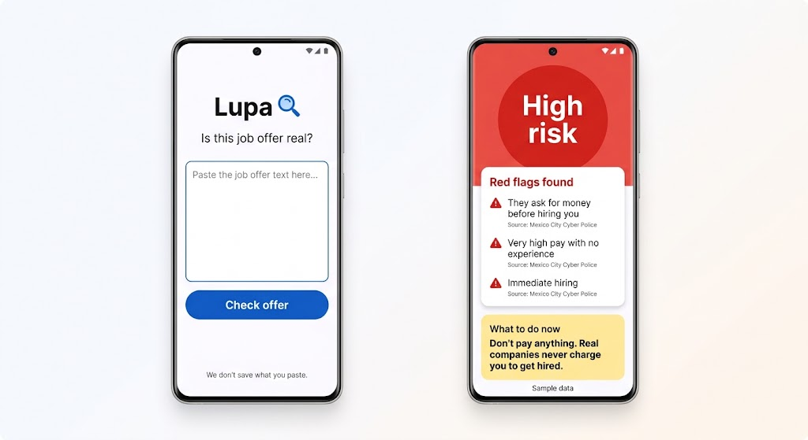
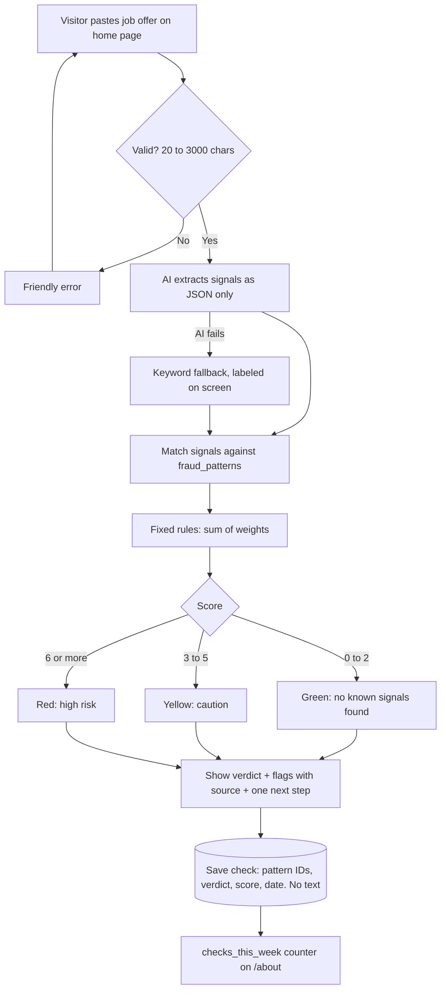
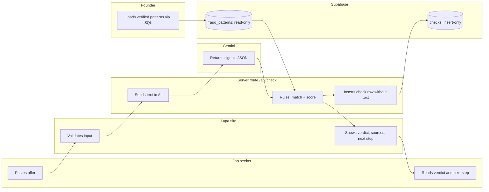

# PACKET — Lupa · Week 12 · The Core Build (venture rebuild)

**Founder:** Rafael Pieck Guerra · **Venture:** Lupa (from Week 9, "The Job Savior", ADVERSARY) · **Repo:** `rafapieck/lupa`
**Method:** *Proof Before Verdict*. Step 3 of the Method ("the AI reads; something verifiable decides") is the engine.
**Referee:** `docs/CHARTER.md` · **Personas:** `docs/PERSONAS.md` · **Week 9 packet:** in git history

> Packet before code. This file and the Charter were committed before any Week 12 application code.

---

## 1. Problem (in my words)

People pushed out of the first job rung look for work in the least protected places: Facebook groups and WhatsApp forwards. That is where scammers wait, asking for money up front ("uniform", "training", "medical exam"), for an INE, or for travel "with housing included". The person decides alone, under time pressure, facing someone who knows exactly what to say, and with nothing to check the offer against. Today they google it and decide on a hunch. Lupa gives them a sourced answer about *their* offer before they pay or hand over documents.

## 2. Exact user

The two personas in `docs/PERSONAS.md`:
- **Karla, 19, Ecatepec.** Lost her call-center job to AI agents. Risk: paying $300–$500 for a fake "uniform".
- **Jorge, 27, Iztapalapa.** Takes whatever comes. Risk: handing over his INE and traveling to an unknown city.

**Real person behind the need:** RPM, a member of my family, saw an offer this month in a Facebook group asking for money up front, and could only google it.

## 3. Success definition

> **Before the module closes**, at the venture's real domain (`lupaempleo.xyz`):
> 1. A visitor pastes a job offer on the home page and, in under 30 seconds, gets a 🟢/🟡/🔴 verdict, each red flag with its official source, and one next step. **The AI only extracts signals; the verdict comes from the verified `fraud_patterns` table and fixed rules.**
> 2. Every completed check is **saved** as a `check` row (matched pattern IDs, verdict, score, date), with **no offer text and no user data**.
> 3. The site has `/product` (how it works) and `/about` (the need, who pays, the 10:1 case), plus a public "checks this week" number, which is the North Star.

## 4. Mockup (image-generated)

*Image-generated mockup from Week 9 (paste screen → verdict screen with matched flags, sources and next step). The core loop didn't change, so the mockup still holds.*

## 5. Flow

### 5.1 Flowchart — the core loop

### 5.2 Swimlane — who does what

## 6. Benchmark

**The best existing solution on Earth for this is** Norton Genie, a general AI scam detector for messages, links and screenshots.
**Mine differs or localizes by** being built only for Mexican job offers: Karla's and Jorge's Spanish, a verdict from verified patterns taken from Mexican official alerts instead of an AI's opinion, every flag with its source, and a Mexican next step (don't pay, verify the company, report to 088 / Policía Cibernética).

## 7. Long view (3 years)

If this core works, Lupa becomes the trust layer of informal job searching in Mexico: a WhatsApp number where anyone forwards a suspicious offer and gets a sourced answer in seconds. The anonymous checks become a living map of active scams by city and platform, shared with job seekers, schools and the Policía Cibernética. It is funded by public and NGO sponsors (employment programs, foundations, crime prevention), never by employers and never by the job seeker, so no payer can ever buy a verdict.

## 8. Who pays (for /about)

**Public and NGO sponsors**, such as government employment programs, foundations working on youth employment, and crime-prevention programs, fund Lupa as prevention. The job seeker never pays. Employers can't pay, so a verdict can never be bought (Charter non-goals). *This week it's a stated model, not a signed sponsor.*

## 9. Blueprint conditions honored (incl. shadow clause)

*To be completed after this week's Team Bending session, with the conditions and the risk register (one risk + one strength from each teammate).*

| Condition | How Lupa honors it |
|---|---|
| *(from the Blueprint)* | |
| **Charter principles carried in by me:** AI never decides · every flag has a source · never "safe" · always a next step · no text or user data stored | Rules-only verdict in `lib/score.ts`; `checks` table has no text column; copy audit for "segura" |

## 10. Scope cut — NOT building this week

- ❌ WhatsApp bot, image/screenshot reading, scam map (3-year vision)
- ❌ User accounts or login: nothing personal is stored, so no auth is needed (security floor)
- ❌ Company verification (RFC/SAT lookups), employer badges, job listings (forbidden zone)
- ❌ Admin panel: patterns are still loaded from the SQL editor
- ❌ Any feature beyond the core loop (my blind spot is over-scoping)

## 11. Architecture + stack

| Layer | Tool | Notes |
|---|---|---|
| Site | Next.js (App Router) + Tailwind | `/` checker · `/product` · `/about` |
| Hosting + domain | Vercel + lupaempleo.xyz (Porkbun, ~US$2 first year) | Real domain is the URL of record |
| AI | Google Gemini Flash (free tier) | Extracts signals only; keyword fallback labeled on screen |
| Verified data | Supabase `fraud_patterns` | RLS ON, public read-only |
| Saved checks | Supabase `checks` | RLS ON, **insert-only** for the server; no public read |
| North Star | `checks_this_week()` SQL function (security definer) | Returns one number, never rows |
| Rules | `lib/score.ts` | Deterministic, tested |
| Secrets | Vercel env vars only | |

**New table `checks`:** `id` (uuid), `created_at` (timestamptz), `verdict` (`green` / `yellow` / `red`), `score` (int 0–100), `pattern_ids` (text[], each must exist in `fraud_patterns`), `simulated` (bool). **No offer text, no IP, no user agent.**

## 12. Test plan

**Mechanical pass**
1. The 5 invented offers from Week 9 still return 🔴🔴🔴🟢🟡.
2. Each check inserts exactly one `checks` row with no text; confirm in Supabase that no column holds the offer.
3. The anon key cannot `select` from `checks` (RLS), and cannot insert a row with a fake verdict outside the enum.
4. `checks_this_week()` returns a number that goes up by 1 after a check.
5. If the save fails, the user still sees the verdict (saving never blocks the answer).
6. `/product` and `/about` load at the real domain; `/about` states the need, who pays and the 10:1 case.
7. Copy audit: no user-facing text says "segura" or "es real".
8. Security floor: `git grep` for keys returns nothing; inputs are validated on client and server.
9. Find at least one bug, fix it, redeploy, and log it in DECISIONS.md.

**Persona pass (Layer 1):** fresh chat as **Jorge** (the new persona), with screenshots of home → result → /about. Log every hesitation, fix the worst one, and save as `PERSONA_RafaelPieck.pdf`.
